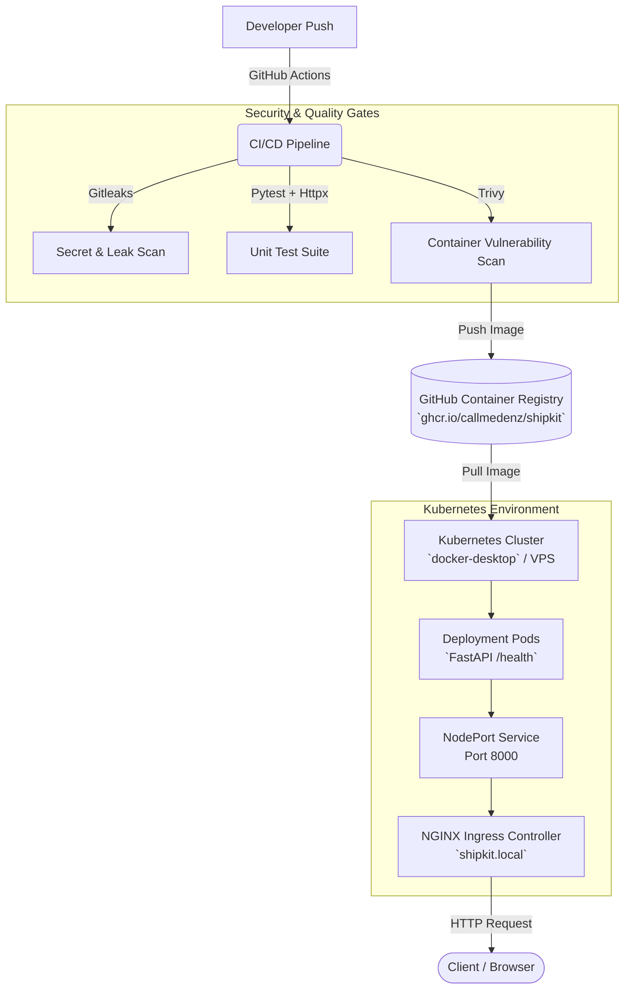

# ShipKit 🚀
**Production-Ready DevSecOps Automation & CI/CD Pipeline for FastAPI Applications**

ShipKit is a lightweight, reusable DevSecOps automation platform designed to streamline security scanning, containerization, and Kubernetes deployment for FastAPI services. It bridges the gap between raw application code and a secure, scalable production environment with zero manual infrastructure overhead.

---

## 🏗️ System Architecture

The following diagram illustrates the complete end-to-end data flow from code commit to local Kubernetes ingress routing:



---

## 🛠️ Tech Stack

* **Application Framework:** FastAPI (Python), tested via `pytest` and `httpx`
* **Security & Compliance:** 
  * **Gitleaks:** Automated secret and credential leak scanning
  * **Trivy:** Container vulnerability scanning
* **Containerization:** Docker, optimized with `.dockerignore` contexts and hosted securely on GitHub Container Registry (`ghcr.io`)
* **Orchestration:** Kubernetes (Local via Docker Desktop / K3s compatible)
* **Traffic Routing:** NGINX Ingress Controller with custom local DNS mapping (`shipkit.local`)
* **CI/CD Automation:** GitHub Actions workflows configured with granular permissions (`contents: read`, `packages: write`, `security-events: write`)

---

## 📂 Repository File Structure

```text
D:\ShipKit\
├── .github\
│   └── workflows\
│       └── ci-cd.yml      # Automated build, security scan, and GHCR push pipeline
├── k8s\
│   ├── deployment.yaml    # Kubernetes Deployment manifest with health probes
│   ├── service.yaml       # Kubernetes Service manifest (NodePort mapping)
│   └── ingress.yaml       # NGINX Ingress controller routing rule
├── argocd\
│   ├── application.yaml   # ArgoCD Application manifest for GitOps sync
│   └── monitoring.yaml    # ArgoCD-managed Prometheus & Grafana stack
├── main.py                # FastAPI application entrypoint with /health endpoint
├── test_main.py           # Pytest suite utilizing TestClient and httpx
├── Dockerfile             # Multi-stage container build definition
├── .dockerignore          # Docker build context exclusions
├── requirements.txt       # Python dependencies (FastAPI, Uvicorn, Httpx)
└── README.md              # Project documentation
```

---

## ⚙️ Core Features & Workflow

1. **Automated Security Gates:** Every push triggers Gitleaks to inspect code for accidental secret leaks and runs unit tests using `pytest` with `httpx`.
2. **Vulnerability Scanning:** Container images are scanned for vulnerabilities via Trivy before being published.
3. **Registry Publication:** Verified images are automatically tagged and pushed to GitHub Container Registry (`ghcr.io/callmedenz/shipkit:latest`).
4. **Resilient Kubernetes Deployment:** Deploys with readiness and liveness probes targeting the `/health` endpoint on port `8000` to ensure high availability.
5. **Seamless Traffic Management:** Handled locally through NGINX Ingress mapping to `http://shipkit.local/health`.

## Gemini Security Remediation

The GitHub Actions pipeline sends HIGH and CRITICAL Trivy findings to Gemini.
Gemini may propose complete replacements for `Dockerfile`, `requirements.txt`, or
`k8s/deployment.yaml`. The proposed edits are restricted to those files and are
submitted as a pull request for human review; the workflow never merges them.

Configure these GitHub repository secrets:

- `GEMINI_API_KEY`: Gemini API key
- `GMAIL_SENDER`: Gmail address used to send alerts
- `GMAIL_RECIPIENT`: Email address that receives alerts
- `GMAIL_APP_PASSWORD`: Gmail App Password

The email step sends an AI-generated security summary after the scan.

## Scheduled AI Health Alerts

[.github/workflows/health-alert.yml](.github/workflows/health-alert.yml) runs
every hour and asks Gemini to turn service health results into an email
status or alert message.

Configure these additional GitHub repository secrets:

- `SHIPKIT_HEALTH_URL`: Public `https://.../health` URL
- `PROMETHEUS_HEALTH_URL`: Public Prometheus `/-/ready` URL
- `GRAFANA_HEALTH_URL`: Public Grafana `/api/health` URL

The workflow also has a manual **Run workflow** button. Services whose URLs
are not configured are reported as not configured; they are not considered
successful health checks.

## Local `.env` Configuration

Copy `.env.example` to `.env`, fill in the Gemini key and Gmail credentials,
and run the local scripts:

```powershell
python -m pip install -r requirements.txt
python scripts/ai_health_alert.py
```

The `.env` file is ignored by Git. Keep real API keys and email credentials out
of `.env.example`, source code, commits, screenshots, and chat logs.

## Testing AI Health Alerts

With ShipKit, Prometheus, and Grafana running, execute:

```powershell
python scripts/ai_health_alert.py
```

The script returns `healthy` or `broken` for each service and asks Gemini to
create a short operations message. It then sends that message through Gmail.
Missing Gmail configuration is reported without stopping the health check.

To test a failure without changing application code:

```powershell
$env:SHIPKIT_HEALTH_URL = "http://localhost:7999/health"
python scripts/ai_health_alert.py
```

The ShipKit result should be `broken` and Gemini should begin the alert with
`ALERT:`. Restore the working value after the test:

```powershell
$env:SHIPKIT_HEALTH_URL = "http://localhost:8000/health"
python scripts/ai_health_alert.py
```

## Testing AI Security Remediation

Build and scan the local Docker image:

```powershell
docker build -t shipkit-local .
trivy image --format json --output trivy-local.json --ignore-unfixed --severity CRITICAL,HIGH shipkit-local
```

Send the findings to Gemini:

```powershell
python scripts/ai_security_fix.py `
  --trivy-json trivy-local.json `
  --summary-output ai-summary.json `
  --email-output ai-email.txt
```

Gemini can propose complete replacements only for `Dockerfile`,
`requirements.txt`, and `k8s/deployment.yaml`. The script applies only paths
listed in that allowlist. Review every change with `git diff` and run tests
before accepting or committing it.

---

## 🚀 Quick Start & Verification

### 1. Run Tests Locally
```powershell
python -m pytest test_main.py
```

### 2. Build and Test Docker Image Locally
```powershell
docker build -t ghcr.io/callmedenz/shipkit:latest .
docker run -d -p 8000:8000 --name shipkit-app ghcr.io/callmedenz/shipkit:latest
curl http://localhost:8000/health
```

### 3. Deploy to Kubernetes Cluster
Apply your manifests to your active cluster context (`docker-desktop` or your remote VPS):
```powershell
kubectl apply -f k8s/deployment.yaml
kubectl apply -f k8s/service.yaml
kubectl apply -f k8s/ingress.yaml
```

### 4. Verify Live Ingress Route
Make sure your Windows hosts file (`C:\Windows\System32\drivers\etc\hosts`) includes:
```text
127.0.0.1 shipkit.local
```
Then, open your browser or run:
```powershell
curl http://shipkit.local/health
```
*(Expected response: `{"status": "healthy", "version": "1.0.0"}`)*